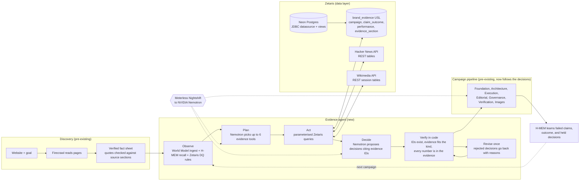

# Flusso

Flusso is a content engine for content creators, content managers and marketers. Give it a website and a campaign goal, and it plans the strategy and audiences, builds a content calendar sized to the team's cadence, and writes platform-native posts for X, LinkedIn, Instagram, TikTok, newsletters and more, with visuals and a production plan. Every claim in the content carries a quote checked against its source, and teams track performance and export the pack.

For the GenAI Works **Open Agent Hackathon 2026** (Wildcard [Tinkerer] track: an existing product, scored on what was built during the hackathon) we added an **evidence agent**. Before anything is written, it turns data, knowledge and memory into a few campaign decisions, and code verifies each one against the evidence it cites.

- **Data:** Zetaris federates Flusso's campaign store (Neon Postgres), Hacker News and Wikimedia pageviews behind one unified semantic layer (USL). The agent queries it as a tool.
- **Knowledge:** the Meterless **World Model** engine holds the brand's verified fact sheet and the live signals, with provenance on every write.
- **Memory:** the Meterless **H-MEM** engine remembers which claims failed for a brand, and why, across campaigns.
- **Reasoning:** NVIDIA **Nemotron 3 Ultra**, served through **Meterless Nightshift**, plans which evidence to pull and proposes decisions. Deterministic code accepts or rejects each one.

The 3 commands below run without any credentials. Each replays a real recorded run.

```bash
npm ci
npm run agent:sample -- samples/allbirds-newsletter
npm run agent:sample -- samples/linear-asks
npm run agent:sample -- samples/wise-freelancers
```

## Contents

- [How it works](#how-it-works)
- [Setup](#setup)
- [Usage](#usage)
- [Sample inputs and outputs](#sample-inputs-and-outputs)
- [Test campaigns](#test-campaigns)
- [Sponsor technology](#sponsor-technology)
- [Logs and traces](#logs-and-traces)
- [Tests](#tests)
- [Dependencies](#dependencies)
- [Pre-existing vs new work](#pre-existing-vs-new-work)

## How it works



1. **Observe.** The fact sheet goes into the World Model as facts about the brand entity, each with its source URL and section. H-MEM recalls memories about this brand that match the goal. Zetaris runs two data-quality rules on the USL, and the results become part of the plan.
2. **Plan.** Nemotron sees the goal, the top world facts, the memories and a menu of 8 tools, then picks up to 6 tools and states a hypothesis. It never writes SQL.
3. **Act.** Each tool is a fixed, parameterised Zetaris query ([lib/agent/evidence-tools.ts](lib/agent/evidence-tools.ts)). Live signals (Hacker News, Wikipedia) are registered as Zetaris REST session tables for the run, queried with SQL, then dropped. Signals also land in the World Model, with the Zetaris query ID as provenance. Every returned row gets an evidence ID such as `claim_risk#2`.
4. **Decide.** Nemotron proposes up to 6 decisions: claim policy, evidence reuse, channel priority, angle, audience, or risk flag. Each must cite evidence IDs.
5. **Verify.** [verifyDecision](lib/agent/reasoning-agent.ts) rejects a decision when:
   - it cites an ID the agent never received;
   - it lacks the right kind of evidence (a claim policy needs claim outcomes or memory, and a channel priority needs performance, audience, attention or memory);
   - it states a number that appears nowhere in its cited evidence or the brief.
6. **Revise once.** Rejected decisions go back to the model with the verifier's reasons. Their replacements are verified again, and anything still rejected stays rejected and visible.
7. **Apply.** Accepted decisions are added to the shared context every campaign stage reads ([lib/agent/prompt.ts](lib/agent/prompt.ts)) and saved on the campaign as `agentPlan`. The app shows them in an **Evidence Agent** tab.
8. **Learn.** After the campaign is saved, H-MEM stores its failed claims, its editorial and proof outcome, and the accepted decisions. Memories that fed an accepted decision get trust feedback in H-MEM's ledger.

The loop is bounded: 6 tool calls, 1 revision round, 2 to 3 model calls per run, and a 60 to 120 s timeout per Zetaris query with 3 attempts on transient errors.

## Setup

Requirements: Node.js 22.6 or later (the tests and scripts use `--experimental-strip-types`), npm, and, for live runs, Docker Desktop with Zetaris plus Meterless Nightshift.

```bash
npm ci
cp .env.example .env.local      # PowerShell: Copy-Item .env.example .env.local
```

### Sample mode (no credentials, no network)

`npm run agent:sample -- <sample dir>`, or `SAMPLE_MODE=true` for the app. This replays the Zetaris rows and Nemotron replies recorded from a live run. The World Model, H-MEM and the verifier still run for real on that input.

### Live mode

1. **Zetaris.** Run the local Zetaris instance (see [zetaris/getting-started](https://github.com/zetaris/getting-started)). Set `ZETARIS_REST_URL`, `ZETARIS_ORG_ID` and `ZETARIS_API_KEY` in `.env.local`. Then:
   ```bash
   npm run zetaris:setup              # dry run: prints every statement, credentials masked
   npm run zetaris:setup -- --apply   # creates the datasource, views, USL, DQ rules, REST tables
   npm run zetaris:explore            # exploratory queries, writes docs/zetaris/exploration.md
   ```
   The setup registers the Neon database from `DATABASE_URL` as a JDBC datasource. Use a read-only Neon role if you prefer.
2. **Meterless Nightshift.** Install Nightshift for Windows (https://www.meterless.ai/windows.html). In **Setup → Providers → Cloud provider keys**, add your NVIDIA key (`nvapi-...`); in **Setup → Local models**, press **Start runtime**. Flusso reads the runtime token from `%LOCALAPPDATA%i.meterless.runtimeproxy-token` automatically, or from `METERLESS_RUNTIME_TOKEN` if you set it; the endpoint is `http://127.0.0.1:8088/v1`. When Nightshift is configured, Flusso sends every text model call to it. Without it, Flusso falls back to OpenRouter.
3. **Neon and Firecrawl** (pre-existing): `DATABASE_URL` (a pooled Neon connection string) and `FIRECRAWL_API_KEY`. `OPENROUTER_API_KEY` is used for images, and for text only when Nightshift is not configured.
4. Check readiness with `curl http://localhost:3207/api/health`. It reports `meterless` as online, unauthorized or offline, and whether Zetaris and OpenRouter are configured.

## Usage

**Evidence Console** (new, the best place to start): `npm run dev -- --port 3207`, then open http://localhost:3207/agent. Pick a brand, choose **Live** (Zetaris + Nightshift) or **Replay** (no credentials), and run. The page streams the agent's reasoning as it happens, counts what each engine contributed (Zetaris queries and rows, World Model facts, H-MEM recalls, and the Nemotron model that answered each call through Nightshift), shows the DQ results, and lists each decision as verified or rejected. Clicking an evidence ID opens the row, fact or memory behind it, with its Zetaris query ID or provenance. It is served by `POST /api/agent`, which streams the same trace records the JSONL logs hold.

**Campaign studio** (pre-existing app, now with the agent step): open http://localhost:3207. Enter a website and a goal and start. The pipeline view shows the Evidence Agent card between Discovery and Foundation. The results open on the **Evidence Agent** tab, where each decision shows its status, evidence IDs and verifier notes.

**Programmatic entry point** (JSON out, traces to stdout and `logs/`):

```bash
npm run agent -- samples/linear-asks               # live: Zetaris + Nightshift
npm run agent:sample -- samples/linear-asks        # replay, no credentials
npm run agent -- samples/linear-asks --record      # live run saved as the new sample
```

A live CLI run plans from the latest fact sheet Flusso stored for that domain. The output goes to `output_examples/<sample>.json`:

```json
{
  "run_id": "live-linear-asks-052dc325",
  "status": "success",
  "output": {
    "provider": "Meterless Nightshift",
    "models": ["nvidia/nemotron-3-ultra-550b-a55b"],
    "decisions": [{ "id": "...", "kind": "channel_priority", "status": "accepted",
                    "statement": "Prioritize LinkedIn for long-form posts that link to Linear blog articles that already attracted high Hacker News engagement ...",
                    "evidenceIds": ["audience_signals#1", "audience_signals#2", "audience_signals#9"] }],
    "dataQuality": [{ "rule": "campaign_has_domain", "total": 19, "valid": 16, "invalid": 3 }]
  },
  "trace_dir": "logs/runs/live-linear-asks-052dc325"
}
```

On failure it prints a structured error (`{"status":"error","error":{"type":...,"message":...}}`) and exits 1.

**HTTP.** `POST /api/generate` with a JSON brief streams server-sent events: `discovery`, `agent` (`running`, `done` with the plan, `skipped`, or `failed`), `stage`, `visuals`, and `complete`.

## Sample inputs and outputs

| Sample | Input | Accepted / rejected | One decision it reached |
|---|---|---|---|
| [allbirds-newsletter](samples/allbirds-newsletter/input.json) | allbirds.com: grow newsletter signups before a running shoe launch | 6 / 0 (4 revised) | Don't claim launch dates, prices or benchmarks for the new shoe: a time-bound claim failed verification in the last Allbirds campaign (`unsupported_claims#1`, `claim_risk#7`). H-MEM recalled 2 memories from that campaign. |
| [linear-asks](samples/linear-asks/input.json) | linear.app: get product teams to adopt Linear Asks for Slack requests | 6 / 2 | Lead on LinkedIn with links to Linear posts that already drew Hacker News engagement (`audience_signals#1`, `#2`, `#9`) |
| [wise-freelancers](samples/wise-freelancers/input.json) | wise.com: get freelancers paid internationally to open an account | 8 / 0 (2 revised) | Don't mention Wise Business cards to US freelancers: card deactivations are a live Hacker News thread (`audience_signals#3`) |

All three were recorded live on 27 October 2026 through Meterless Nightshift, with every model request answered by `nvidia/nemotron-3-ultra-550b-a55b` (see `logs/telemetry.jsonl`), and Zetaris as the data layer. Full outputs are in [output_examples/](output_examples/): `<sample>.json` is the live recording and `<sample>.sample.json` is its replay. Rejections are kept and shown: on Linear, the verifier rejected a risk flag that stated numbers (5, 6) its evidence didn't contain, and an "open question" that cited no evidence.

## Test campaigns

Full campaigns run in the app during the build window, from website and goal to strategy, content calendar, platform-native posts, claim checks and editorial review. All are stored in the Neon campaign store and readable through the Zetaris `brand_evidence` USL.

| Date (UTC) | Brand | Goal | Platforms | Posts | Calendar days | Claims checked / supported / unsupported | Editorial | Evidence agent | Model |
|---|---|---|---|---|---|---|---|---|---|
| 27 Oct 21:32 | Allbirds | Newsletter signups before a running shoe launch | Newsletter, X | 5 | 7 | 7 / 4 / 3 | 88 | 6 decisions | Nemotron 3 Ultra via Nightshift |
| 27 Oct 08:41 | Allbirds | Newsletter signups before a running shoe launch | Newsletter, X | 5 | 7 | 30 / 11 / 0 | 94 | 5 decisions | gpt-5.6-luna via OpenRouter |
| 27 Oct 06:07 | Linear | Adopt Linear Asks for Slack requests | LinkedIn, X | 8 | 14 | 29 / 21 / 0 | 94 | - | gpt-5.6-luna via OpenRouter |
| 27 Oct 04:57 | Allbirds | Newsletter signups before a running shoe launch | Instagram, TikTok | 6 | 14 | 24 / 12 / 0 | 91 | - | gpt-5.6-luna via OpenRouter |
| 27 Oct 04:49 | Allbirds | Newsletter signups before a running shoe launch | Instagram, TikTok | 6 | 14 | 24 / 13 / 0 | 91 | - | gpt-5.6-luna via OpenRouter |
| 27 Oct 02:12 | Linear | Engineering managers start a Linear trial | LinkedIn, X | 8 | 14 | 28 / 16 / 0 | 92 | - | gpt-5.6-luna via OpenRouter |
| 26 Oct 21:14 | Wise | Freelancers open a Wise account | LinkedIn, Medium | 6 | 14 | 24 / 6 / 0 | 93 | - | gpt-5.6-luna via OpenRouter |
| 26 Oct 21:13 | charity: water | Recruit monthly donors to The Spring | LinkedIn, Newsletter | 6 | 14 | 23 / 8 / 0 | 93 | - | gpt-5.6-luna via OpenRouter |
| 26 Oct 21:09 | Allbirds | Newsletter signups before a running shoe launch | Newsletter, X | 6 | 14 | 20 / 13 / 0 | 94 | - | gpt-5.6-luna via OpenRouter |
| 26 Oct 08:03 | Doma | Onboard domain traders onchain | X, Discord | 5 | 7 | 22 / 4 / 2 | 91 | - | gpt-5.6-luna via OpenRouter |
| 26 Oct 07:51 | Doma Protocol | Onboard domain traders onchain | X, Discord | 5 | 7 | 21 / 13 / 0 | 91 | - | gpt-5.6-luna via OpenRouter |
| 25 Oct 22:57 | Doma | Onboard domain traders onchain | X, Discord | 5 | 7 | 22 / 4 / 2 | 91 | - | gpt-5.6-luna via OpenRouter |

Claims that are neither supported nor unsupported are editorial framing or time-sensitive statements, which the proof report tracks separately. Unsupported claims are flagged in the proof report for review, not published silently.

The most recent run is the full product on the sponsor stack: the evidence agent and all six writing stages ran on NVIDIA Nemotron 3 Ultra through Meterless Nightshift, in about 14 minutes. Its complete delivery pack (strategy, audience segments, calendar, posts, claims with their quotes, editorial report, and the agent's verified decisions) is in [output_examples/campaigns/allbirds-nightshift.json](output_examples/campaigns/allbirds-nightshift.json). Earlier runs used OpenRouter before Nightshift was set up, and the first evidence-agent run (27 Oct 08:41) predates the agent's move to Nightshift.

## Sponsor technology

### Zetaris: the agent's data layer

Zetaris is where the agent gets every fact it reasons about that isn't on the brand's own pages. Details, DDL and reflections are in [docs/zetaris/README.md](docs/zetaris/README.md). Real query results are in [docs/zetaris/exploration.md](docs/zetaris/exploration.md).

- **Three sources:**
  - `flusso_neon`, a JDBC datasource over Neon with 4 datasource views that unpack the jsonb campaign packs at the source;
  - Hacker News, as Lightning REST tables in `flusso_signals` and as per-run REST session tables;
  - Wikimedia pageviews, as per-run REST session tables.
- **USL:** `lightning.metastore.flusso.brand_evidence` with 4 tables (`campaign`, `claim_outcome`, `performance`, `evidence_section`), keyed on `campaign_id` and aligned on `domain`.
- **Data quality:** `claim_status_known` and `campaign_has_domain`. The agent runs both at the start of every run. Live result on 27 October: 378 of 378 claims valid, and 3 of 19 campaigns lack a domain and stay out of every brand's evidence.
- **Code:**
  - REST client with retries: [lib/agent/zetaris.ts](lib/agent/zetaris.ts)
  - objects: [lib/agent/zetaris-catalog.ts](lib/agent/zetaris-catalog.ts)
  - tools: [lib/agent/evidence-tools.ts](lib/agent/evidence-tools.ts)
  - setup and exploration: [scripts/zetaris-setup.mjs](scripts/zetaris-setup.mjs), [scripts/zetaris-explore.mjs](scripts/zetaris-explore.mjs)

### Meterless: engines and Nightshift

| Engine | Mounted at | What it does in Flusso | Feature it powers | Test |
|---|---|---|---|---|
| **World Model** | [lib/agent/world-state.ts](lib/agent/world-state.ts), using [vendor/meterless/world-model](vendor/meterless/world-model) | Ingests the verified fact sheet (first-party facts at 0.9 confidence, third-party at 0.7), competitor entities and relationships, and the live Zetaris signals, all with provenance. A context builder (spec section 8.2) ranks facts by the goal. | The evidence the planner sees, and the `fact:` and `audience_signals#` IDs decisions cite | [tests/meterless-engines.test.mjs](tests/meterless-engines.test.mjs) |
| **H-MEM** | [lib/agent/brand-memory-engine.ts](lib/agent/brand-memory-engine.ts), using [vendor/meterless/hmem](vendor/meterless/hmem) | One tiered store per brand domain in `.flusso/hmem/<domain>`, with H-MEM's own `ledger.jsonl`. It learns failed claims, campaign outcomes and accepted decisions after each campaign, recalls them by goal before the next one, and gives cited memories trust feedback. | Memory across campaigns: the `mem-` IDs decisions cite | [tests/meterless-engines.test.mjs](tests/meterless-engines.test.mjs) |

Both engines are Meterless's reference implementations (Apache-2.0, commit `1742dec`). The only changes: import specifiers are extensionless, and constructor parameter properties are written out, so Node's type stripping runs them. Neither engine calls a model. The agent passes its model in as a generator function ([lib/agent/generator.ts](lib/agent/generator.ts)), and sample mode swaps in a replay generator.

**Nightshift** is the primary text provider ([lib/model-provider.ts](lib/model-provider.ts)), following the Meterless Runtime 0.90 contract:
- the base URL is normalised to `<host>/v1`;
- every request sends `Authorization: Bearer <runtime token>`, `meterless-app: flusso` and `meterless-scope: user`;
- every request asks for `nvidia/nemotron-3-ultra-550b-a55b` by name (a routing mode such as `meterless/auto` can go in `METERLESS_MODEL` instead), at low reasoning effort;
- the timeout is 10 minutes, since the largest campaign stage takes about 6.5 minutes on Nemotron 3 Ultra;
- `GET /v1/models` decides online, unauthorized or offline.

Every campaign stage and agent step goes through it when it is configured. The model that actually answered is read from each response and logged, so the logs prove which model handled it. A full Allbirds campaign has run this way end to end: six stages and five assets, all on Nemotron 3 Ultra through Nightshift.

### NVIDIA

The evidence agent's plan, decide and revise steps run on **NVIDIA Nemotron**. Every request logs its `answeredBy` model and a `nemotron: true|false` flag in `logs/telemetry.jsonl`. Through Nightshift the agent asks for `nvidia/nemotron-3-ultra-550b-a55b`, which Nightshift serves from NVIDIA's hosted endpoints with the key in its KEYS tab; `meterless/auto` alone routed a test request to the smaller Nemotron 3.5 Bolt. All 9 model requests in the committed live runs were answered by Nemotron 3 Ultra through Nightshift.

We tried 4 Nemotron variants on the same decide input ([lib/agent/reasoning-agent.ts](lib/agent/reasoning-agent.ts) keeps the token budgets this produced):

| Model and reasoning setting | Result on the decide step |
|---|---|
| Nemotron 3 Super, reasoning low | Thought past a 16k-token budget without answering |
| Nemotron 3 Super, reasoning off | Valid answer in 9 s |
| Nemotron 3.5 Lightning | Valid, but 43 s |
| **Nemotron 3 Ultra, reasoning low** | **Valid in 15 s, with the most specific decisions. Default.** |

### Cursor

Not used. This project was built with Claude Code.

### What was unique about our use

- **Zetaris as an evidence ledger.** Every row the agent reads gets a citable ID, and code refuses any decision that cites a row the agent never received, or a number its rows don't contain. The USL's shared `domain` key and DQ rules make that evidence consistent across sources.
- **The agent onboards live sources into Zetaris.** For each run it registers a REST session table for the brand, reads it with SQL, and drops it afterwards.
- **Memory from governance, not chat.** H-MEM remembers which kinds of claims failed for a brand and why, plus which decisions held up, so the next campaign starts from that.
- **The model is never the judge of its own evidence.** Nemotron plans and proposes, and deterministic code verifies.

## Logs and traces

Each run writes JSONL to `logs/` (all runs) and to `logs/runs/<run id>/` (one run), and prints a readable line per record to stdout.

| File | Contents |
|---|---|
| `trace.jsonl` | Each step: H-MEM recall with scores, DQ results, the plan, each tool call and result, every Zetaris query with its SQL, verifier verdicts with reasons, retries and errors |
| `telemetry.jsonl` | Zetaris query timings and row counts; per model request: provider, requested model, model that answered, Nemotron flag, tokens, duration |
| `audit.jsonl` | Writes: World Model ingests, H-MEM memories written and feedback given, Zetaris objects created by setup (credentials masked) |
| `provenance.jsonl` | Each accepted decision with its full evidence chain: World Model provenance, H-MEM provenance label, or Zetaris query ID |

H-MEM keeps its own append-only ledger at `.flusso/hmem/<domain>/ledger.jsonl`. The World Model is rebuilt for each run from that run's fact sheet and signals, because fact IDs are unique only within one fact sheet; its audit trail goes to `logs/audit.jsonl`.

## Tests

```bash
npm test            # 132 tests, including the agent, engine, adapter, and sample-mode tests
npx tsc --noEmit
npx eslint .
```

New test files:
- [tests/evidence-agent.test.mjs](tests/evidence-agent.test.mjs): the verifier, the full loop with a fake Zetaris and a scripted model (including a revision), a failing tool, and session table cleanup.
- [tests/meterless-engines.test.mjs](tests/meterless-engines.test.mjs): H-MEM learn and recall across process restarts, and World Model provenance and context ranking.
- [tests/sponsor-adapters.test.mjs](tests/sponsor-adapters.test.mjs): the Zetaris REST contract and retries, the setup plan, Nightshift URL normalisation, provider choice and status probe, and record and replay.
- [tests/sample-mode.test.mjs](tests/sample-mode.test.mjs): every sample replays with `fetch` stubbed to throw and reaches the recorded verdicts.

## Dependencies

- **Runtime:** Next.js 15, React 19, `openai` (the client for both Nightshift and OpenRouter), `zod`, `@neondatabase/serverless`, `@phosphor-icons/react`.
- **Services:**
  - Zetaris Lightning, running locally in Docker;
  - Meterless Nightshift, with an NVIDIA API key in its Providers tab;
  - Neon Postgres;
  - Firecrawl;
  - OpenRouter (images, and text when Nightshift is not configured).
- **Vendored:** Meterless H-MEM and World Model reference engines ([vendor/meterless](vendor/meterless), Apache-2.0, see [vendor/meterless/LICENSE](vendor/meterless/LICENSE)). Neither has runtime dependencies.
- **Public data:**
  - Hacker News Search API by Algolia (public, no key);
  - Wikimedia REST API pageviews (CC0 data, used with a descriptive User-Agent);
  - Wikipedia title search.

## Pre-existing vs new work

The build window opened on 22 October 2026, 00:00 UTC. Run `git log --since=2026-10-22` for the new commits.

| | What | When |
|---|---|---|
| **Pre-existing (declared)** | Flusso's core content engine: Firecrawl discovery, campaign strategy, the content calendar and scheduling, the six-stage campaign pipeline (Foundation to Verification), claim governance and the proof report, the Neon store, exports, and the Next.js UI. These are 37 commits, the last on 15 October 2026. | Before 22 Oct |
| **Pre-existing data (declared)** | 8 of the campaigns in Neon, created 9 July to 15 October 2026. The agent reads their claim outcomes through Zetaris. Every later campaign, and every captured source section, is from the build window. | Before 22 Oct |
| **Third-party (declared)** | Meterless reference engines (vendored, Apache-2.0); Zetaris REST contract and SQL syntax from zetaris/getting-started | Upstream |
| **New, Phases 1 to 3** | Evidence-checked claims, heading-delimited source sections, the verified fact sheet with gap research, strategy statement and success criteria, the separate hook review, automatic images, the per-domain brand model, the voice guide, and document upload | 25 to 27 Oct |
| **New, hackathon integration** | Everything under `lib/agent/`, `lib/model-provider.ts`, the Zetaris setup and objects, the Evidence Agent UI, the scripts, samples, tests and docs described in this README | 27 Oct |


The pre-existing VPS deployment is described in [deploy/README.md](deploy/README.md).
